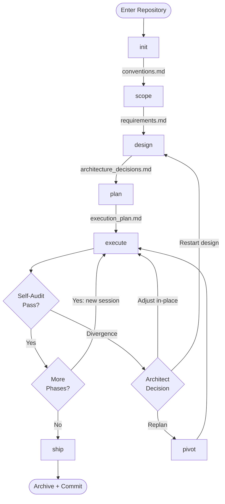
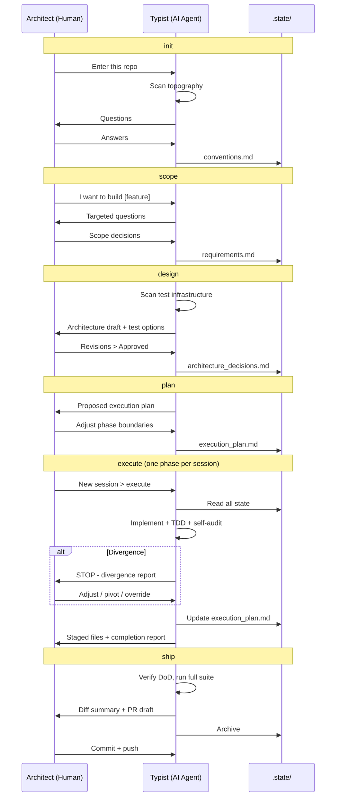
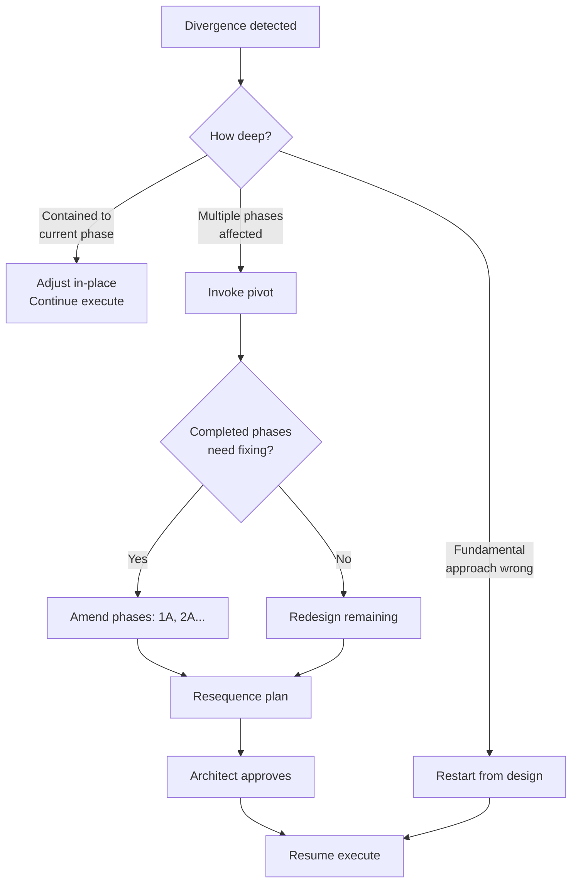

# The Architect-Typist Workflow

Model and tool agnostic agentic coding.

You decide. The AI builds.

A disciplined pipeline for shipping features with AI agents.
The human stays in the architect seat, setting direction, making
decisions, owning every commit. The AI is the typist: fast, capable,
but never in charge.

All state is local. All decisions are human. All commits are
human-authorized.

Model-agnostic. Tool-agnostic. Language-agnostic. Framework-agnostic.

---

## Why I Built This

I started out coding with AI agents the way most people do: blindly,
with no real plan and no shared context. It felt fast at first. Then,
quite soon, I was out of the loop. The agent was producing code I
hadn't decided on and couldn't follow, and every change made it
harder to steer. Getting back in control was a struggle, and in the
end I removed all of it and started over.

This workflow is what I built afterwards, from scratch, to make sure
that never happens again. I plan before the agent types. The context
lives in files I can read. The work moves in short steps I can check.
Later I found that a lot of people have been converging on similar
ideas, which you'll find under
[Related Approaches](#related-approaches).

---

## Philosophy

AI agents can write code faster than anyone can read it. That is the
opportunity, and it is also the problem. Speed only helps if you still
understand, and still own, what ends up in your repo.

This workflow rests on four ideas.

**You stay in control.** The agent is a capable typist, not a decision
maker. You set the scope, choose the design, approve every plan and
every phase, and make every commit. Nothing moves forward because the
agent decided it should.

**You drive with context, not prompts.** An agent is only as good as
what it knows. Instead of re-explaining yourself in every chat, the
context lives in plain files: conventions, requirements, design
decisions, the plan, and field notes. You can read them, edit them,
and hand them to any tool. The agent works from the same page you do,
and you can always see what that page says.

**Trust comes from checks, not magic.** The agent is never a black
box. Every phase names its target files and how it will be verified.
Self-audits and the Definition of Done are ticked only with evidence:
a command's output, a test, or a line of code. When the work drifts
from the plan, the agent stops and tells you instead of quietly
working around it. That is what lets you trust the output without
rereading every line with suspicion. You trust it because you can see
what was checked.

**Short bursts, never long runs.** Letting an agent run long and
unattended is the surest way to lose control. Work moves in small
phases, each one verified and approved before the next begins. One
phase per session keeps the context fresh and the diff small enough
to actually read. If something goes wrong, you lose one phase, not a
week.

### Comprehension Debt

When code arrives faster than understanding, a new kind of debt builds
up: code that works, but that nobody on the team can explain. It
doesn't show up in a linter or a test run. It shows up later, during an
incident, a refactor, or a handover, when someone has to reason about
code that no person ever really held in their head.

The workflow pays this down as it goes. The decisions are yours before
any code exists, so the shape of the work is yours too. Each phase is
small enough to actually review. And when you need to catch up,
`explain` builds a mental model from small pieces up to the big
picture, while `ask` answers questions straight from the code, with
references and an honest "I don't know" when that is the truth.

### What It Isn't

It isn't a brake on speed. The agent still writes the code, and it
writes it fast. Ceremony scales with the work: a one-line fix goes
through `fast`, and a feature goes through the full pipeline. The goal
isn't to slow the agent down. It's to keep you in the loop at the
moments that matter.

---

## What It Fixes

AI agents are powerful but not accountable. They optimize for
completion, not correctness. Without structure, they silently drift
from the plan, skip edge cases, and ship code that looks right but
isn't.

This workflow fixes three failure modes:

**Context death.** Sessions expire. Windows close. Token limits
truncate history. `.state/` files survive all of it. The agent
rebuilds understanding from files, never from conversation memory.

**Compounding errors.** One large session is fragile. One mistake
cascades into everything after it. Phased execution bounds the
blast radius: each phase is independently verifiable. If something
breaks, you lose one phase of work, not all of it.

**Silent drift.** Agents don't stop when they're wrong. They work
around problems. Human gates at every phase boundary force
engagement with the actual output. Divergence detection makes
drift visible, cheap, and fixable.

---

## Quick Start

### 1. Add the skills

**Claude Code:**
```bash
scripts/sync-skills.sh
```

Claude Code loads each skill from `~/.claude/skills/<name>/SKILL.md`.
The script installs every `skills/<slug>.md` as
`as-<slot>-<slug>/SKILL.md`, where `<slot>` comes from the skill's
`metadata.slot`: `p1`-`p7` for pipeline, `u1` and up for utilities.
It rewrites the frontmatter `name:` to match the folder.

- Prefixing keeps skills from colliding with built-in commands such
  as `/init`. Installed commands are `/as-p1-init`, `/as-u4-roadmap`,
  and so on. These docs use the bare names.
- Re-run after every pull or edit. `skills/` is the source of truth.
  Edits made to installed copies are overwritten.
- Removed or renamed skills are reported as `stale`. Delete those
  folders by hand.
- Options: `scripts/sync-skills.sh <dest>` installs elsewhere, such
  as a project's `.claude/skills`. `SKILL_PREFIX=xx` changes the
  prefix.
- Windows: run it from Git Bash or WSL.

**Any other agent:**
The skills are plain markdown. Load `skills/*.md` however your tool
supports persistent instructions: system prompts, context files, or
paste. `metadata.slot` is safe to ignore.

### 2. Initialize

```
/as-p1-init
```

The agent scans your repo, asks questions, and writes
`.state/conventions.md`. Plain `/init` in Claude Code runs the
built-in CLAUDE.md generator, not this skill.

### 3. Build something

```
/as-p2-scope for this task: add rate limiting to the API
```

Then follow the pipeline. One skill at a time. One approval at a time.

---

## The Pipeline

Seventeen skills. Seven form the core pipeline. Ten are utilities you
reach for when you need them.

```
init  →  scope  →  design  →  plan  →  execute  →  ship
                                   ↑
                             pivot (escape hatch)
```

Each pipeline skill reads from `.state/`, does its job, writes back
to `.state/`, and waits for the architect to approve before the next
skill runs.



### Pipeline Skills

| # | Skill | What it does | Produces |
|---|-------|-------------|----------|
| P1 | [init](skills/init.md) | Enter the repo, learn conventions | `conventions.md` |
| P2 | [scope](skills/scope.md) | Debate and define what to build | `requirements.md` |
| P3 | [design](skills/design.md) | Architect the solution, choose test strategy | `architecture_decisions.md` |
| P4 | [plan](skills/plan.md) | Break work into phased vertical slices | `execution_plan.md` |
| P5 | [execute](skills/execute.md) | Build one phase, verify, self-audit | Code + updated plan |
| P6 | [ship](skills/ship.md) | Verify DoD, archive state, prepare commit | Archive + staged changes |
| P7 | [pivot](skills/pivot.md) | Replan when direction changes | Updated planning state |

### Utility Skills

Use these anytime, inside or outside the pipeline.

| Skill | What it does |
|-------|-------------|
| [orient](skills/orient.md) | Get your bearings in an existing workspace |
| [fast](skills/fast.md) | Fast path for trivial tasks or exploratory spikes |
| [review](skills/review.md) | Independent code review with verified, ranked findings |
| [roadmap](skills/roadmap.md) | Quick estimates, or epic planning into sized GitHub issues |
| [triage](skills/triage.md) | Read-only incident triage and diagnosis |
| [artifacts](skills/artifacts.md) | Draft PRs, team updates, and documents |
| [forge](skills/forge.md) | Turn a rough skill idea into a proper skill |
| [maintain](skills/maintain.md) | Run structured maintenance on existing skills |
| [explain](skills/explain.md) | Mental model of code, completed work, or a plan, built in small chunks |
| [ask](skills/ask.md) | Conversational repo Q&A, answered from the code |

---

## How It Works

The pipeline is a conversation between two roles. The boundary is
strict.



### Who Owns What

| Action | Architect | Typist |
|--------|:---------:|:------:|
| Set direction and scope | **owns** | asks questions |
| Make architecture decisions | **owns** | proposes options |
| Approve designs and plans | **owns** | waits |
| Write code | reviews | **owns** |
| Run verification | reviews output | **owns** |
| Self-audit against the plan | reviews honestly | **owns** |
| Detect divergence and stop | can also catch | **owns** |
| Decide to pivot or continue | **owns** | recommends |
| Commit, push, create PR | **owns** | only when asked |

---

## .state/

Everything the agent needs to know lives in `.state/` at the repo
root. It survives context window wipes, session restarts, and tool
switches. The agent reads these files to rebuild understanding. It
never relies on conversation history.

| File | Written By | Read By | Purpose |
|------|------------|---------|---------|
| `resume.md` | Any skill | `orient`, then owning skill | Session handoff bookmark |
| `conventions.md` | `init` | All skills | Conventions and field notes |
| `requirements.md` | `scope` | `design` through `ship` | Approved scope and DoD |
| `architecture_decisions.md` | `design` | `plan` through `ship` | Approved technical design |
| `execution_plan.md` | `plan` | `execute`, `ship`, `pivot` | Phase-by-phase state, Draft or Approved |
| `roadmap.md` | `roadmap` | `roadmap`, `orient` | Approach, issue breakdown, GitHub numbers |
| `maintain/` | `maintain` | `maintain` | Maintenance campaign memory |
| `archive/` | `ship` | Human reference | Completed work history |

### What Gets Committed

| File | Git? | Why |
|------|:----:|-----|
| `conventions.md` | **Yes** | Team-shared knowledge |
| `maintain/` | **Yes** | Repo-tracked maintenance memory |
| Everything else | No | Ephemeral or local-only |

```gitignore
.state/*
!.state/conventions.md
!.state/maintain/
!.state/maintain/**
```

---

## Guardrails

These aren't suggestions. They're embedded in the skills and enforced
by the agent.

**One phase at a time.** No parallel execution. The architect
approves before the next phase starts.

**Approved plans only.** `plan` and `pivot` write plans as Draft.
`execute` refuses to run until the architect approves.

**Evidence, not claims.** Self-audit items and Definition of Done
items are ticked only with evidence: command output, a test, or
`file:line`.

**3-Strike Rule.** Three consecutive test/build/lint failures and the
agent stops, documents the error, and waits. No brute-forcing.

**Honest Failure.** Declaring a phase FAILED is a success. The agent
caught the problem before it compounded. Hiding mistakes is the
actual failure.

**Divergence Detection.** If implementation drifts from the plan, the
agent stops and reports. It never self-corrects silently.

**Clean Baseline.** `execute` runs the build before changing
anything. A broken starting point is reported, not built on.

**Protected Plan.** During execution the agent can only update the
current phase's status and record. Rewriting the plan to match the
code counts as drift.

**Targeted Staging.** Explicit file paths only. No `git add .`.

**200-Line Conventions Cap.** The conventions file consolidates
rather than growing unbounded.

### Action Authority

| Action | Authority |
|--------|-----------|
| Read files | Autonomous |
| Write code to target files | Autonomous (current phase only) |
| Run build/test/lint | Autonomous |
| Stage files (explicit paths) | Autonomous |
| Append to conventions | Autonomous (200-line cap) |
| Update execution plan | Autonomous (status + audit) |
| Commit / Push / Create PR | **Delegated** (only when asked) |
| Create or delete branches | **Delegated** (only when asked) |
| Create GitHub issues | **Delegated** (`roadmap`, after approval) |
| Touch files outside target list | **Prohibited** (triggers divergence) |
| Advance to next phase | **Prohibited** (architect gates every phase) |
| Self-correct a divergence | **Prohibited** (must stop and report) |
| 4th fix attempt after 3-Strike | **Prohibited** (must stop and wait) |

---

## When Things Go Wrong



---

## Commands

### Core Pipeline

Run these in order. Each one feeds the next.

| Skill | Invocation | What happens |
|-------|-----------|-------------|
| `init` | `/init` | Scans repo, writes `conventions.md` |
| `scope` | `/scope for: [describe task]` | Debates scope, writes `requirements.md` |
| `design` | `/design` | Drafts architecture, writes `architecture_decisions.md` |
| `plan` | `/plan` | Breaks into phases, writes `execution_plan.md` |
| `execute` | `/execute` | Builds next pending phase (one per session) |
| `ship` | `/ship` | Verifies DoD, archives state, stages commit |
| `pivot` | `/pivot because [reason]` | Replans when direction changes |

### Utilities

Use anytime.

| Skill | Invocation | What happens |
|-------|-----------|-------------|
| `orient` | `/orient` | Reads `.state/`, reports where you are |
| `fast` | `/fast [task]` | Fast path for trivial tasks or spikes |
| `review` | `/review` | Reviews staged, unstaged, or branch diff |
| `roadmap` | `/roadmap [task or goal]` | Quick estimate, or plans an epic into GitHub issues |
| `triage` | `/triage [symptom]` | Diagnoses an issue, read-only |
| `artifacts` | `/artifacts [type]` | Drafts a PR, update, or document |
| `forge` | `/forge on [draft]` | Audits and rewrites a rough skill |
| `maintain` | `/maintain on [feedback]` | Runs maintenance on existing skills |
| `explain` | `/explain [code, branch, or plan]` | Explains in small illustrated chunks, read-only |
| `ask` | `/ask [question]` | Answers repo questions from the code, read-only |

Installed with `scripts/sync-skills.sh`, commands carry the slot
prefix: `/as-p1-init`, `/as-u4-roadmap`.

### Habits

- Follow the pipeline in order.
- Run `/execute` repeatedly, one phase per session.
- Use `/pivot` instead of silently changing direction.
- Use `/orient` when returning to a repo with existing `.state/`.
- Use `/fast` for small tasks that don't need full planning.
- Use `/roadmap` when unsure whether a task is trivial or large.
- Use `/ask` or `/explain` to understand code without starting work.

---

## See It In Action

The [tech talk](docs/tech-talk/README.md) walks through the entire
pipeline on a real codebase
([bill-splitter](https://github.com/aakarshsingh/bill-splitter)).
Four features go from empty `.state/` to shipped PR, with mocked
outputs for every pipeline skill along the way.

What it covers:

- Every pipeline skill, init through ship, with full output artifacts
- Session resume: the architect steps away mid-project, returns hours
  later, and the agent picks up with zero context loss
- A near-divergence caught by self-audit and deferred to a later phase
- A post-execution pivot where the architect finds UX problems and the
  agent generates a surgical amend phase
- Field notes discovered, tracked, and resolved across phases
- The release planned beforehand with `roadmap`, as sized GitHub
  issues
- A teammate getting up to speed afterwards with `explain` and `ask`

---

## Related Approaches

I built this from scratch, out of my own frustration. Since then, many
people have converged on similar shapes, which is reassuring. Here's
how they line up.

| Approach | Core idea | In this workflow |
|----------|-----------|------------------|
| Spec-driven development: [GitHub Spec Kit](https://github.github.com/spec-kit/), Kiro | Write the spec before the code: constitution or steering, then spec, plan, tasks | `conventions.md`, `requirements.md`, `architecture_decisions.md`, `execution_plan.md` |
| [Research, Plan, Implement](https://github.com/humanlayer/advanced-context-engineering-for-coding-agents) | Compact each phase into an artifact to keep context small | `design` reads the code, `plan` compacts it, `execute` starts fresh each phase |
| [Long-running agent harnesses](https://www.anthropic.com/engineering/effective-harnesses-for-long-running-agents) | Progress file, one feature per session, verify before declaring done | `execution_plan.md`, `resume.md`, one phase per session, evidence on every tick |
| [Context engineering](https://www.anthropic.com/engineering/effective-context-engineering-for-ai-agents) | Context is a finite budget. Keep notes outside the window. | `.state/` is the memory. Sessions are disposable. |
| [Explore, plan, code, commit](https://code.claude.com/docs/en/best-practices) | Plan when the change is uncertain. Skip it when the diff fits in one sentence. | Full pipeline vs `fast` |
| [Comprehension debt](https://www.oreilly.com/radar/comprehension-debt-the-hidden-cost-of-ai-generated-code/) | Code nobody understands is a hidden cost that breeds false confidence | `explain`, `ask`, small reviewable phases |

Where this workflow differs:

- **Authority, not just artifacts.** Spec tools center the spec. This
  workflow centers who decides. Every gate is a human approval, and
  the agent never commits.
- **Drift stops the work.** A
  [common critique of spec-driven tools](https://www.martinfowler.com/articles/exploring-gen-ai/sdd-3-tools.html)
  is that agents ignore the spec anyway, which gives a false sense of
  control. Here, divergence from the plan is a hard stop with a
  report, not something to discover in review.
- **Ceremony scales.** A heavy spec process on a small bug is a
  sledgehammer on a nut. `roadmap` sizes the work first, and `fast`
  handles anything you could describe in one sentence.
- **Specs are working documents, not the source.** Requirements,
  design, and plan are archived after ship. Only conventions persist
  and evolve. The code stays the source of truth.
- **Understanding is built in.** Passing tests isn't the same as
  understanding. `explain` and `ask` exist for the second part.
- **Nothing to install.** Plain markdown, any model, any agent. A sync
  script exists for Claude Code, but the skills work anywhere you can
  load instructions.

---

## FAQ

**Can I skip phases?**
Yes. Hand-write `requirements.md` and jump to `plan`. The skills
communicate through files, not conversation.

**When should I use `fast` instead of the full pipeline?**
Single bug fix, config change, narrow refactor, small test addition.
If it touches more than two files or needs a design decision, use the
pipeline.

**When should I use `roadmap`?**
Before any task where you're unsure whether it's trivial or large,
use quick estimate mode. Its size maps to a motion: fast path, spike,
or full pipeline. For an epic or milestone, roadmap mode breaks the
work into GitHub issues. Each issue then enters the pipeline on its
own.

**`ask` or `explain`?**
`ask` answers specific questions, one at a time. `explain` walks
through a whole area, change, or plan, building up to the big
picture. Both are read-only.

**Can I use multiple AI tools?**
Yes. `.state/` is plain markdown. Start with Claude, continue with
Cursor, finish with whatever. The files carry the state.

**Context window filled up?**
New session, re-invoke `execute`. The files are the continuity
mechanism.

**Disagree with the self-audit?**
You're the architect. Override anything.

**Team use?**
`conventions.md` is committed and shared. Execution state stays
local to each developer.

---

## Project Structure

```
README.md
docs/
  cheatsheet.md        Quick reference for all 17 skills
  tech-talk/           Full pipeline walkthrough with mocked outputs
scripts/
  sync-skills.sh       Install skills into Claude Code
skills/
  Pipeline
  init.md              P1  enter repo, learn conventions
  scope.md             P2  define what to build
  design.md            P3  architect the solution
  plan.md              P4  break into phases
  execute.md           P5  build one phase
  ship.md              P6  close the cycle
  pivot.md             P7  replan when needed

  Utilities
  orient.md                get your bearings
  fast.md                  fast path or spike
  review.md                code review
  roadmap.md               estimates and issue breakdown
  triage.md                incident triage
  artifacts.md             draft PRs and updates
  forge.md                 create new skills
  maintain.md              improve existing skills
  explain.md               chunked explanations
  ask.md                   repo Q&A
```
